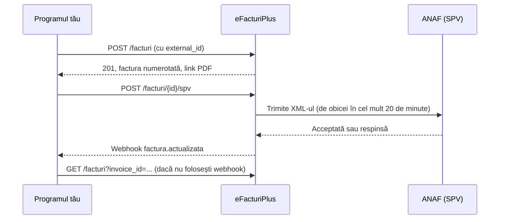

# Cum funcționează

eFacturiPlus emite facturi în contul unei firme și le trimite în SPV (e-Factura, ANAF). API-ul permite oricărui program să facă asta: magazin online, ERP, aplicație proprie.

## Pașii unei facturi

1. **Primești cererea.** Cheia din antetul `X-Api-Key` stabilește firma.
2. **Se validează.** Dacă ceva e greșit primești `422` și nu se scrie nimic.
3. **Se emite.** Dacă lipsește `numar_facura`, se dă următorul număr din serie. Seria se creează la prima folosire. Cererile simultane pentru aceeași firmă se fac pe rând, deci numerele nu se dublează.
4. **Rămâne în contul firmei.** Titularul o vede în aplicație, cu PDF, încasări și stare.
5. **Se trimite în SPV,** la cerere sau automat, dacă firma a pornit trimiterea automată din Integrări. **Trimiterea la ANAF nu se poate retrage.**
6. **ANAF răspunde,** iar starea se actualizează. Primești webhook sau citești starea.

Dacă o factură e greșită după emitere, se face stornare (`POST /facturi/{id}/storno`) și, la nevoie, o factură nouă.

## Stările

`invoice.status`

| Stare | Sens |
|---|---|
| `ciorna` | Proiect, fără număr și fără PDF; titularul îl confirmă din aplicație |
| `emisa` | Emisă |
| `incasata_partial`, `incasata` | Are încasări |
| `anulata` | Anulată |

`efactura_status`

| Stare | Sens |
|---|---|
| `netrimisa` | Nu a plecat la ANAF |
| `in_asteptare` | E în coadă, pleacă automat |
| `in_prelucrare` | E la ANAF |
| `acceptata` | Acceptată în SPV |
| `respinsa` | Respinsă; motivele sunt în `efactura.errors` |
| `trimisa` | Încărcată din aplicația veche, fără stare cunoscută |
| `eroare_trimitere` | Trimiterea automată a eșuat; motivul e în `efactura.errors` |

## Ce trebuie să aibă firma

- Cont activ, cu abonament pornit. Altfel: `402`.
- Autorizare ANAF pentru SPV, făcută o dată din aplicație, la **Firma mea → e-Factura (SPV)**. Fără ea facturile se emit, dar nu pleacă la ANAF. `GET /cont` arată starea în `spv.connected`.

## Cum eviți dublurile

Trimite mereu `external_id`, id-ul comenzii din programul tău. A doua cerere cu același id întoarce aceeași factură, cu `duplicate: true`. Așa poți repeta liniștit o cerere după un timeout.

## Reîncercări

Bibliotecile din `sdks/` repetă singure cererile la `429` și `503`, unde nu s-a scris nimic. După o eroare de rețea nu știu dacă cererea a ajuns, deci repetă doar citirile. Pentru o creare fără răspuns, repet-o tu, cu același `external_id`.
